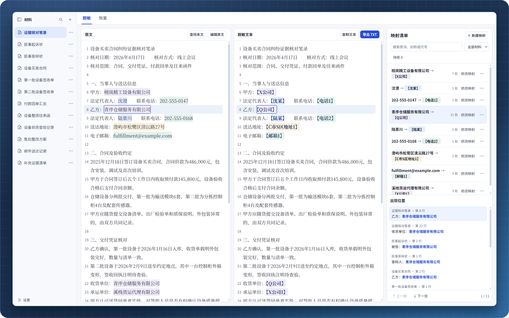

<p align="center">
  
</p>

<h1 align="center">LegalRedactor</h1>

<p align="center">法律文档脱敏工具</p>

<p align="center">
  <strong><a href="https://github.com/zhuziqi97/legal-redactor/releases/latest">下载最新版</a></strong> ·
  <a href="#从源码运行">从源码运行</a> ·
  <a href="#反馈与贡献">反馈与贡献</a>
</p>

<p align="center">
  
</p>

LegalRedactor 用于在共享或进一步处理法律文档前，识别和替换其中的敏感信息。识别、复核和导出均在本机离线完成。

## 主要功能

- **识别与复核**　从 Word（DOCX）、TXT 或粘贴文本中识别敏感信息，并对照原文修订脱敏结果。
- **多文档脱敏**　同一项目的多份文档共用代号，可在映射清单中定位原文。
- **保存项目**　项目可加密保存，重新打开后继续复核。
- **恢复与导出**　把脱敏代号恢复为对应原词，结果可复制或导出为 TXT。

## 下载

目前提供 Windows x64 和 Linux x64 版本。下载对应系统的版本，解压后即可运行。

[查看发布版本](https://github.com/zhuziqi97/legal-redactor/releases)

## 从源码运行

需要 Node.js 24 或更新版本。可用[模型准备脚本](scripts/prepare-release-model.py)生成本地 ONNX 模型，再将 `REDACTOR_ONNX_DIR` 指向模型目录。

```sh
npm ci
npm run build
npm start
```

运行 `npm test` 执行测试。

## 反馈与贡献

欢迎在 [GitHub Issues](https://github.com/zhuziqi97/legal-redactor/issues) 反馈问题和提出建议，也欢迎提交 Pull Request。

## 许可证

项目采用 [Apache-2.0](LICENSE) 许可。版权与第三方归属见 [NOTICE](NOTICE)。
